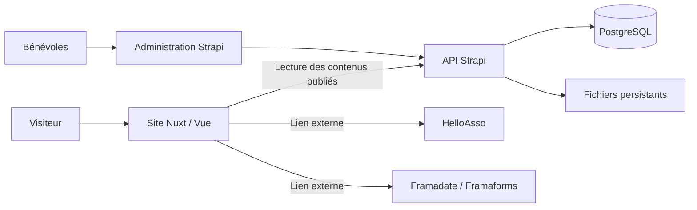

# 04 — Choix techniques recommandés

Décisions actualisées le **7 novembre 2026** après validation : Vue/Nuxt, Strapi,
PostgreSQL, Docker Compose en local puis sur OVH, images construites dans GitHub
Actions. **WordPress est exclu de la nouvelle stack.**

## Recommandation

Je recommande **Nuxt + Vue 3 + TypeScript**, avec **Strapi 5** pour l’administration
et **PostgreSQL** pour les contenus. Conserver **HelloAsso**, les liens **Framadate**
et **Framaforms** au lancement.

Le CMS permet aux bénévoles de publier sans passer par le dépôt de code.
L’interface publique utilise Vue ; l’interface d’administration fournie par Strapi
utilise React, sans développement React spécifique dans ce projet.

## Stack proposée

| Couche | Choix | Justification |
| --- | --- | --- |
| Interface publique | Nuxt, Vue 3, TypeScript | Écosystème Vue, pages rendues côté serveur, routage et évolution progressive |
| Présentation | CSS avec variables de design et composants Vue ; Tailwind CSS possible selon ta préférence | Une identité graphique cohérente sans imposer une grosse bibliothèque de composants |
| CMS et API | Strapi 5, API REST | Administration prête à configurer, contenus structurés, médias et permissions |
| Données | PostgreSQL dans une version supportée par le CMS | Données relationnelles, sauvegarde et portabilité |
| Agenda | Liste HTML et grille mensuelle Vue dans la première version | La liste reste lisible au mobile et le calendrier apporte la vue d’ensemble |
| Inscriptions | Liens HelloAsso | Préserver le processus actuel de paiement et d’adhésion |
| Sondages | Liens vers le service Framadate actuel | Éviter une migration des réponses et une gestion de comptes au lancement |
| Médias | Stockage persistant sauvegardé ; stockage objet compatible S3 si l’hébergement l’exige | Les fichiers doivent survivre aux déploiements du CMS |
| Vérification | Vitest pour les règles de dates ; Playwright pour les parcours essentiels | Tester les points sensibles et les permissions, sans multiplier les tests de présentation |
| Livraison | Git, intégration continue, préproduction puis production | Changements contrôlés et possibilité de retour arrière |

Nuxt fournit plusieurs modes de rendu, dont le rendu serveur et le rendu hybride.
Le HTML initial peut ainsi contenir les textes utiles à la lecture et au
référencement. Source : [modes de rendu Nuxt](https://learn.nuxt.com/en/concepts/rendering-modes).

Strapi fournit une administration extensible et des types de contenus. Le mode
brouillon/publication est disponible mais doit être activé ; les permissions de
l’administration se configurent séparément des accès à l’API publique.
Sources : [présentation Strapi](https://docs.strapi.io/cms/intro),
[brouillons et publication](https://docs.strapi.io/cms/features/draft-and-publish),
[rôles d’administration](https://docs.strapi.io/cms/features/rbac).

PostgreSQL est pris en charge par Strapi. La nouvelle base devra être créée pour
Strapi : on importe les contenus WordPress transformés, on ne branche pas Strapi
sur ses tables existantes. Source : [configuration de la base](https://docs.strapi.io/cms/configurations/database).

La première grille mensuelle est réalisée directement en Vue pour limiter les
dépendances. FullCalendar reste une option si le besoin évolue vers des vues plus
complexes. Source : [intégration Vue](https://fullcalendar.io/docs/vue).

## Architecture proposée

Le serveur Nuxt lit uniquement les données publiées avec des droits minimaux.
Les secrets restent sur le serveur. La prévisualisation des brouillons utilise un
accès distinct et protégé. Aucun droit d’écriture public n’est nécessaire en V1.

Commencer par un rendu serveur avec un cache court sur les contenus publics.
L’expiration du cache doit être compatible avec l’affichage d’une annulation ;
prévoir une purge lors des publications importantes. Les pages de prévisualisation
et d’administration ne doivent pas être mises en cache publiquement.

L’export et l’abonnement ICS sont des fonctions à réaliser côté serveur ;
FullCalendar ne remplace pas leur implémentation. Conserver des identifiants ICS
stables et gérer correctement les changements d’heure et annulations.

## Décisions de développement et de livraison

- Node.js 24 dans Docker, Nuxt 4.6.4 et Strapi 5.61.0, dépendances verrouillées dans les deux `package-lock.json`.
- Deux Dockerfiles avec cibles `development` et `production` ; images de production autonomes, sans sources montées depuis le serveur.
- Compose local avec rechargement des sources, PostgreSQL et volumes persistants.
- GitHub Actions vérifie le projet et construit les deux images. Les pull requests ne publient pas d’images ; `main` et les tags `v*` publient sur GHCR.
- Sur OVH, un Compose distinct tire les images identifiées par SHA Git ou tag de version. Le déploiement reste manuel à ce stade.
- Un fichier optionnel raccorde le frontend au Traefik existant. Le CMS reste accessible en local ou par tunnel SSH.

Le dépôt de référence `jjehl/canin_premiere_langue` a été examiné via sa copie locale,
notamment ses Compose, Dockerfile et workflow. On reprend le principe images →
registre → Compose OVH / Traefik. Les différences sont explicites : GHCR remplace
le registre Scaleway, le rendu Nuxt nécessite Node au lieu de Nginx seul, et aucun
accès SSH ni déploiement automatique n’est configuré dans la CI.

Voir le [guide Docker et CI](06-docker-et-ci.md) pour les commandes.

## Hébergement et coût d’exploitation

L’hébergement retenu est un **serveur OVH avec Docker Compose**. PostgreSQL et les
fichiers du CMS résident dans des volumes distincts. Traefik peut assurer HTTPS et
le routage du frontend. Le serveur doit sauvegarder ces volumes vers un emplacement
indépendant ; Docker Compose ne fournit pas une sauvegarde à lui seul.

Le coût total comprend hébergement, stockage, sauvegardes, domaine, éventuels
emails et temps de maintenance. Demander un chiffrage après estimation du volume
de photos et des besoins de disponibilité ; aucun tarif fournisseur n’est supposé
gratuit ou garanti ici.

Le cœur communautaire de Strapi est sous licence MIT, avec des parties Enterprise
soumises à d’autres conditions ; les fonctions payantes ne sont pas incluses par
défaut dans cette recommandation. Les workflows avancés et l’historique éditorial
complet doivent être évalués séparément si nécessaires.
Sources : [licence du dépôt](https://github.com/strapi/strapi/blob/develop/LICENSE),
[fonctionnalités et offres associées](https://docs.strapi.io/cms/intro).

## Maintenance et vérification

Épingler les dépendances, choisir une version Node.js compatible avec Nuxt et
Strapi, séparer préproduction et production et sauvegarder base **et** médias.
Documenter une restauration testée ainsi qu’une passation à un autre bénévole.

Les vérifications prioritaires sont : publication sans exposition des brouillons,
redirections, disponibilité des liens externes, agenda autour des changements
d’heure, navigation mobile et clavier, et restauration des contenus. Une PWA,
des microservices, un serveur temps réel et une application mobile dédiée
n’apportent pas de bénéfice nécessaire au périmètre actuel.
